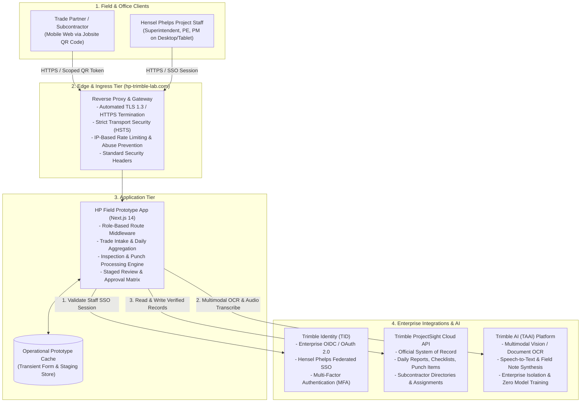
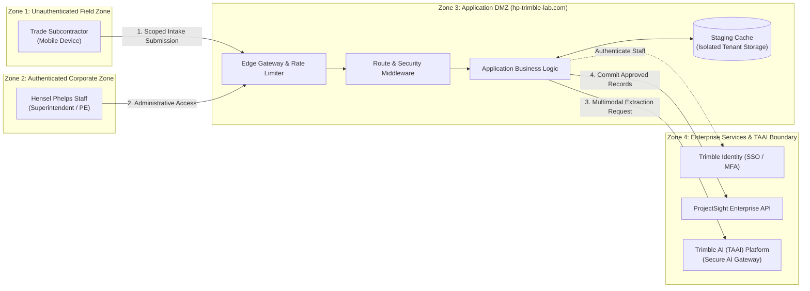
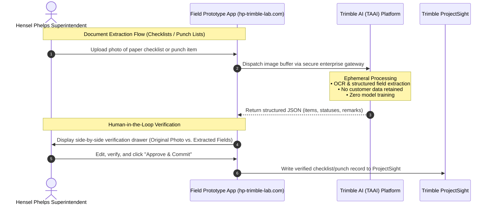

# Hensel Phelps & Trimble Field Operations Prototype
## Architecture, Security & Privacy Brief

**Target Environment:** `https://hp-trimble-lab.com`  
**Audience:** Hensel Phelps IT Leadership, Security & Privacy Officers, and Project Stakeholders  
**Date:** September 2026  
**Status:** Active Prototype & Evaluation Architecture  

---

## 1. Executive Summary

This document provides a high-level architectural, security, and data privacy overview of the **Hensel Phelps & Trimble Field Operations Prototype** hosted at `hp-trimble-lab.com`. 

The initiative modernizes jobsite daily reporting, checklist inspections, and punch list workflows by:
1. Providing a frictionless, mobile-optimized daily intake for trade contractors via jobsite QR codes.
2. Utilizing artificial intelligence to digitize physical paperwork (checklists, punch sheets, and field voice notes) into structured digital records.
3. Giving Hensel Phelps superintendents and project engineers a consolidated review and approval workflow ("Superdaily").
4. Synchronizing verified, superintendent-approved records directly into **Trimble ProjectSight** as the official System of Record.

To satisfy Hensel Phelps enterprise data governance and privacy policies, all machine intelligence in this architecture is routed through the **Trimble AI (TAAI) Platform**, ensuring complete tenant data isolation, zero retention for model training, and adherence to enterprise compliance standards.

---

## 2. High-Level System Architecture

The prototype is organized into four distinct tiers: Field Clients, Edge & Ingress, Application Core, and Enterprise Integrations.

### Component Breakdown

1. **Field & Office Clients:**
   - **Trade Subcontractors:** Access a lightweight, mobile-responsive web intake by scanning a physical QR code on the jobsite. No corporate Trimble or Hensel Phelps login is required, eliminating field onboarding friction while maintaining strict scope boundaries.
   - **Hensel Phelps Staff:** Access the administrative dashboard, Superdaily review matrix, checklist management, and ProjectSight sync tools using corporate Single Sign-On.

2. **Edge & Ingress Tier:**
   - Hosted on a hardened cloud virtual environment behind a reverse proxy (Caddy).
   - Enforces TLS 1.3, strict Content Security Policies (CSP), HSTS, frame protection (`SAMEORIGIN`), and MIME sniffing prevention (`nosniff`).
   - Implements tiered rate limiting at the IP and endpoint level to protect against denial-of-service and brute-force attacks.

3. **Application Tier:**
   - Built on Next.js 14 (App Router) and TypeScript.
   - Manages request routing, role-based access validation, trade form submission handling, and human-in-the-loop verification staging.
   - Maintains an operational cache for staging pending subcontractor submissions and OCR extractions prior to superintendent approval.

4. **Enterprise Integrations & Intelligence Tier:**
   - **Trimble Identity (TID):** Centralized identity management for staff authentication and authorization.
   - **ProjectSight API:** Bi-directional data synchronization for projects, trade companies, daily logs, checklists, and punch lists.
   - **Trimble AI (TAAI) Platform:** Enterprise AI infrastructure providing computer vision (OCR) and natural language extraction without exposing customer data to public model providers.

---

## 3. Security Architecture & Trust Boundaries

The system enforces clear trust boundaries between public on-site trade interactions and authenticated corporate management.

### Trust Zones Explained

| Zone | Actors | Access Level | Controls & Safeguards |
| :--- | :--- | :--- | :--- |
| **Zone 1: Field Intake** | Subcontractors, Trade Foremen | Write-only to assigned project intake endpoints (`/intake/*`) | • Scoped strictly to daily labor, work descriptions, and photos • Zero read access to other trade contractors' data • Zero access to project financials, schedules, or staff notes • Dedicated rate limiting (60 requests/minute) |
| **Zone 2: Corporate Portal** | Hensel Phelps Superintendents, PEs | Full management, review, approval, and ProjectSight sync | • Enforced corporate SSO via Trimble Identity (TID) • Multi-Factor Authentication (MFA) supported • Encrypted HTTP-only, SameSite session cookies |
| **Zone 3: Application DMZ** | Next.js Service, Reverse Proxy | Orchestration and transient staging | • Perimeter TLS termination • Strict HTTP headers and CSP • DDoS and burst rate throttling • No plain-text secrets in source control |
| **Zone 4: Enterprise Integrations** | ProjectSight API, TAAI Platform | System-to-system data exchange | • Mutual TLS / HTTPS communication • Least-privilege API operator tokens • Tenant-isolated AI processing |

---

## 4. Artificial Intelligence Governance: Trimble AI (TAAI) Platform

A central consideration for Hensel Phelps IT and Security is ensuring that proprietary construction data, drawings, paper forms, and field notes are never ingested into public foundation models.

In this architecture, all generative AI, vision extraction, and speech processing are routed exclusively through the **Trimble AI (TAAI) Platform**.

### Direct Public LLMs vs. Trimble AI (TAAI) Platform

| Dimension | Public AI / Direct Commercial API | Trimble AI (TAAI) Platform |
| :--- | :--- | :--- |
| **Customer Data Usage** | May be subject to vendor evaluation or model improvement unless enterprise opt-outs are strictly negotiated | **Zero Model Training Guarantee:** Customer data is contractually isolated and never used to train or tune foundation models. |
| **Data Retention** | Often retained by third-party clouds for 30+ days for abuse monitoring | **Ephemeral Processing:** Prompts, images, and audio are processed in-memory and discarded upon response delivery. |
| **Enterprise Boundary** | Direct connection to external vendor endpoints | Managed behind Trimble’s secure enterprise infrastructure and compliance boundary. |
| **Security & Compliance** | Varies by provider; requires separate vendor assessments | Governed under Trimble enterprise security agreements and SOC 2 Type II audit controls. |
| **Credential Management** | Static API keys scattered across application environments | Centralized enterprise service authentication, token rotation, and audit trails. |

### Human-in-the-Loop Principle

The system adheres to a strict **"Human-in-the-Loop" (HITL)** architecture:
- **No Autonomous Commit:** AI outputs (transcriptions, OCR text, crew counts) are treated exclusively as *suggested drafts*.
- **Superintendent Review:** Hensel Phelps staff must review, adjust, and approve all data before any record is committed to ProjectSight.
- **Traceability:** Every finalized record maintains an audit log indicating the submitting trade, the approving staff member, and the approval timestamp.

---

## 5. Data Privacy & Confidentiality Controls

### 1. Data Ownership
- **100% Customer Owned:** Hensel Phelps retains sole ownership of all data inputted into the system, including images, audio logs, daily reports, and labor tracking.
- **No Secondary Use:** Trimble does not sell, monetize, or use Hensel Phelps project data for secondary analytical purposes without explicit authorization.

### 2. Trade-to-Trade Data Isolation
- Subcontractors on job sites often compete with one another. The field intake interface strictly isolates trade submissions:
  - Electricians cannot view drywallers' crew counts, hours, or notes.
  - Subcontractors cannot view project-wide critical path schedules or internal superintendent notes.
  - Subcontractors only receive confirmation of their own daily submission.

### 3. Encryption Standards
- **Data in Transit:** All traffic between clients, the reverse proxy, application servers, TAAI, and ProjectSight is encrypted using TLS 1.3 / HTTPS. Insecure HTTP connections are automatically redirected with permanent 301/308 redirects.
- **Data at Rest:** All transient storage volumes and databases are encrypted using industry-standard AES-256 encryption.

### 4. Rate Limiting & Denial of Service Protection
The application implements multi-tier rate limiting enforced directly at the ingress middleware:
- **Authentication Endpoints (`/api/auth/*`, `/login`):** 30 requests per minute per IP.
- **Field Intake Endpoints (`/api/intake/*`, `/api/dailyreports`):** 60 requests per minute per IP.
- **General Navigation & Data Fetching:** 180 requests per minute per IP.
- Violations trigger an HTTP `429 Too Many Requests` response with a standard `Retry-After` header.

---

## 6. Enterprise Integration with ProjectSight

Trimble ProjectSight is the authoritative System of Record (SoR) for Hensel Phelps projects. The prototype is designed as an edge operational layer that feeds into ProjectSight rather than replacing it:

1. **Project Directory Ingestion:** The prototype reads authorized project IDs, company directories, and trade assignments from ProjectSight.
2. **Standardized Daily Reports:** Approved field logs are compiled into standardized ProjectSight Daily Report records, including weather observations, labor hours, and work descriptions.
3. **Checklists & Quality Inspections:** Scanned field checklists map directly to ProjectSight Checklist tables (TableType 189), preserving sort orders, item statuses (Pass/Fail/NA), and comments.
4. **Punch List Items:** Identified punch issues are synchronized to ProjectSight Punch Lists with assigned contractors, locations, and priority levels.

---

## 7. Frequently Asked Security & Privacy Questions (FAQ)

**Q1: Does the AI model retain Hensel Phelps jobsite photos or voice recordings?**  
*No.* All AI processing is routed through the Trimble AI (TAAI) Platform under an enterprise agreement. Image buffers and audio clips are processed ephemerally in volatile memory to generate structured JSON outputs and are immediately released.

**Q2: Can trade contractors access internal Hensel Phelps project information through the QR code?**  
*No.* The QR code resolves to a scoped, public intake form. It does not provide access to the superintendent dashboard, project financials, scheduling models, or other subcontractors' submissions.

**Q3: How are Hensel Phelps employee accounts authenticated?**  
*Via Trimble Identity (TID).* Hensel Phelps staff log in using Trimble's corporate identity system, which integrates with enterprise federated single sign-on (SSO) and enforces company multi-factor authentication (MFA) policies.

**Q4: What happens if the AI makes an error during document OCR or transcription?**  
*Human review catches it.* AI output is never pushed directly to the permanent record. Superintendents and project engineers use a side-by-side verification interface where they inspect the source image and edit any fields before committing the record to ProjectSight.

**Q5: What are the transport security specifications for `hp-trimble-lab.com`?**  
The domain is configured with automated TLS certificate management, enforcing TLS 1.3 with modern cipher suites, HTTP Strict Transport Security (HSTS) with subdomains and preload, `X-Content-Type-Options: nosniff`, and `X-Frame-Options: SAMEORIGIN`.

---

## 8. Summary & Next Steps

This architecture provides Hensel Phelps with the productivity benefits of mobile field intake and automated AI document processing while adhering to strict enterprise security and data privacy requirements:

- **Trimble AI (TAAI) Platform** guarantees data confidentiality and zero model training.
- **Trimble Identity (TID)** ensures authenticated corporate governance for project staff.
- **ProjectSight Integration** maintains a clean, single source of truth for all construction records.

Trimble welcomes review and collaboration with Hensel Phelps IT and security teams to validate these controls as the project progresses toward broader jobsite deployment.
